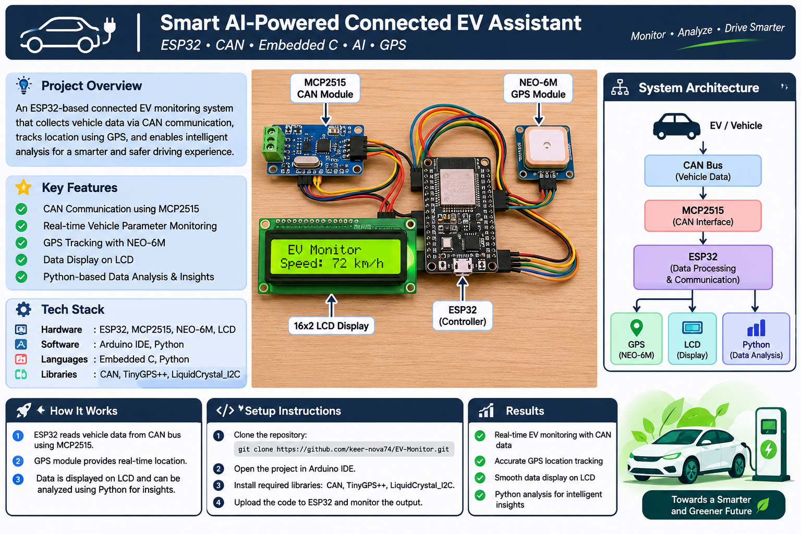

# Smart AI-Powered Connected EV Assistant

A two-node ESP32 connected-vehicle monitoring prototype developed with the Arduino IDE. The project demonstrates CAN communication between a simulated vehicle ECU and a dashboard ECU, GPS location acquisition, LCD display, and Python-based analysis of serial data.

> **Prototype note:** The transmitter sketch currently generates simulated vehicle parameters. It does not connect to or decode a real vehicle/EV CAN network. Real vehicle integration requires the correct CAN bitrate, message IDs, signal definitions, and an electrically compatible interface.

## 1. System overview

- **ESP32 #1 – Vehicle ECU / Transmitter:** Generates sample speed, battery voltage, motor temperature, and state-of-charge (SOC) values. Sends them as a CAN frame through an MCP2515 module.
- **ESP32 #2 – Dashboard ECU / Receiver:** Receives the CAN frame through its MCP2515 module, reads NEO-6M GPS data, displays speed and SOC on a 16x2 I2C LCD, and prints CSV records over USB serial.
- **Python analysis:** Reads the receiver's serial CSV output, saves it to a file, and prints basic statistics.

## 2. Hardware required

- 2 × ESP32 development boards
- 2 × MCP2515 CAN modules (each module should include a CAN transceiver)
- 1 × NEO-6M GPS module
- 1 × 16x2 I2C LCD
- Jumper wires and suitable power supplies
- CAN bus wiring; 120-ohm termination at the two physical ends of the bus

### Important electrical notes

1. Each ESP32 requires its own MCP2515 CAN module to form two CAN nodes.
2. Connect CANH to CANH and CANL to CANL. Connect grounds between the nodes.
3. Use 120-ohm termination at each end of the CAN bus. Do not add extra termination if it is already fitted to the modules.
4. **ESP32 GPIO pins are not 5-V tolerant.** MCP2515 boards vary: check the board's logic voltage and transceiver. Use a 3.3-V-compatible CAN module or suitable level shifting where required. Do not connect a 5-V logic output directly to an ESP32 GPIO.
5. Check the oscillator fitted to each MCP2515 board (commonly 8 MHz or 16 MHz). The example code is configured for 8 MHz; change the constant in both sketches if your boards use 16 MHz.
6. The example uses a 500-kbit/s CAN bitrate. Both nodes must use the same bitrate.

## 3. Wiring

### Both ESP32 boards to their MCP2515 modules (SPI)

| MCP2515 pin | ESP32 pin |
|---|---:|
| SCK | GPIO 18 |
| SO (MISO) | GPIO 19 |
| SI (MOSI) | GPIO 23 |
| CS | GPIO 5 |
| INT | GPIO 4 |
| VCC / GND | According to module specifications / GND |

### GPS module to ESP32 #2

| NEO-6M pin | ESP32 #2 pin |
|---|---:|
| TX | GPIO 16 (ESP32 RX2) |
| RX | GPIO 17 (ESP32 TX2) |
| GND | GND |
| VCC | According to GPS breakout specifications |

The GPS module's TX connects to the ESP32's RX. Cross the UART data lines.

### I2C LCD to ESP32 #2

| I2C LCD pin | ESP32 #2 pin |
|---|---:|
| SDA | GPIO 21 |
| SCL | GPIO 22 |
| GND | GND |
| VCC | According to LCD backpack specifications |

Some LCD I2C backpacks pull SDA/SCL up to 5 V. Use a bidirectional I2C level shifter or a 3.3-V-compatible pull-up arrangement so ESP32 pins are not exposed to 5 V.

## 4. CAN data format

The transmitter sends one standard 11-bit CAN frame:

- **CAN ID:** `0x100`
- **DLC:** 8 bytes
- **Byte 0–1:** Speed × 10 (unsigned, little-endian)
- **Byte 2–3:** Battery voltage × 100 (unsigned, little-endian)
- **Byte 4–5:** Motor temperature × 10 (signed, little-endian)
- **Byte 6–7:** SOC × 10 (unsigned, little-endian)

This is a project-defined demonstration format, not a standard automotive CAN/OBD-II message definition.

## 5. Arduino IDE setup

1. Install ESP32 board support in Arduino IDE and select your ESP32 board.
2. Install these libraries through **Library Manager**:
   - **MCP2515** by autowp (header: `mcp2515.h`)
   - **TinyGPSPlus** by Mikal Hart
   - **LiquidCrystal I2C** (a compatible `LiquidCrystal_I2C.h` library)
3. Open `ESP32_Vehicle_Transmitter/ESP32_Vehicle_Transmitter.ino`, select the board and COM port, then upload it to ESP32 #1.
4. Open `ESP32_Dashboard_Receiver/ESP32_Dashboard_Receiver.ino`, select the board and COM port, then upload it to ESP32 #2.
5. Wire the two MCP2515 modules to the CAN bus. Power both nodes.
6. Connect the receiver ESP32 to the computer and open Serial Monitor at **115200 baud**. The receiver outputs CSV rows.
7. For GPS, test outdoors with a clear view of the sky. Until a valid fix is available, latitude and longitude are printed as `0`.

### MCP2515 oscillator setting

Both sketches contain:

```cpp
#define MCP2515_CLOCK MCP_8MHZ
```

If your modules have a 16-MHz crystal, change it to `MCP_16MHZ` in **both** sketches.

## 6. Python serial data logging

Install Python dependencies:

```bash
pip install pyserial
```

Run:

```bash
python Python_Analysis/ev_data_logger.py --port COM5 --baud 115200
```

Replace `COM5` with the receiver ESP32's actual serial port (for example, `COM3`). On Linux, it may look like `/dev/ttyUSB0`.

The script saves incoming rows to `ev_vehicle_log.csv` and prints basic speed, voltage, temperature, and SOC statistics when stopped with Ctrl+C.

## 7. Repository structure

```text
Smart_AI_Connected_EV_Assistant/
├── ESP32_Vehicle_Transmitter/
│   └── ESP32_Vehicle_Transmitter.ino
├── ESP32_Dashboard_Receiver/
│   └── ESP32_Dashboard_Receiver.ino
├── Python_Analysis/
│   └── ev_data_logger.py
├── docs/
│   └── system_architecture.png
└── README.md
```

## 8. Troubleshooting

- **No CAN frames:** Check CANH/CANL polarity, common ground, termination, matching bitrate, oscillator setting, and both MCP2515 modules.
- **MCP2515 initialization fails:** Check SPI wiring, CS pin, module power, and oscillator frequency.
- **LCD is blank:** Check I2C wiring and scan for the correct I2C address (`0x27` or `0x3F` are common).
- **GPS has no fix:** Test outdoors, verify UART cross-wiring, and confirm the module's baud rate (default sketch setting: 9600).
- **Python cannot open serial port:** Close Arduino Serial Monitor before running the Python script; only one program can usually own the serial port at a time.

## 9. Future enhancements

- Replace simulated values with actual vehicle ECU signals after obtaining the correct CAN database/message definitions.
- Add fault-code handling and threshold-based alerts.
- Add SD-card or cloud logging.
- Add validated energy-efficiency analytics and predictive maintenance models.

## 10. Project image



---

**Technologies:** ESP32, Arduino IDE, Embedded C/C++, MCP2515, CAN, NEO-6M GPS, I2C LCD, Python, PySerial.
